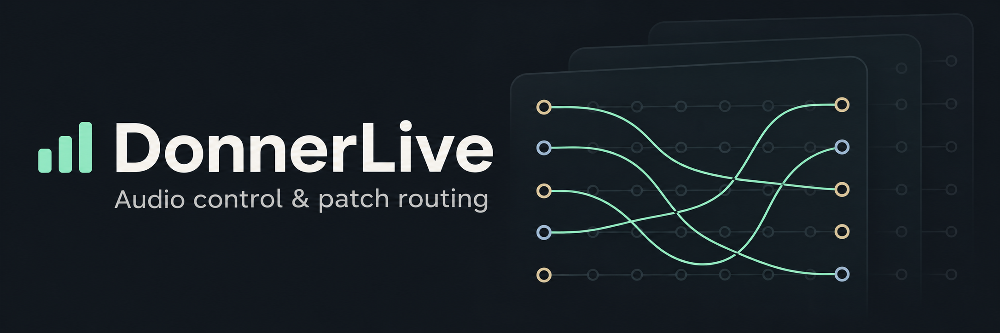
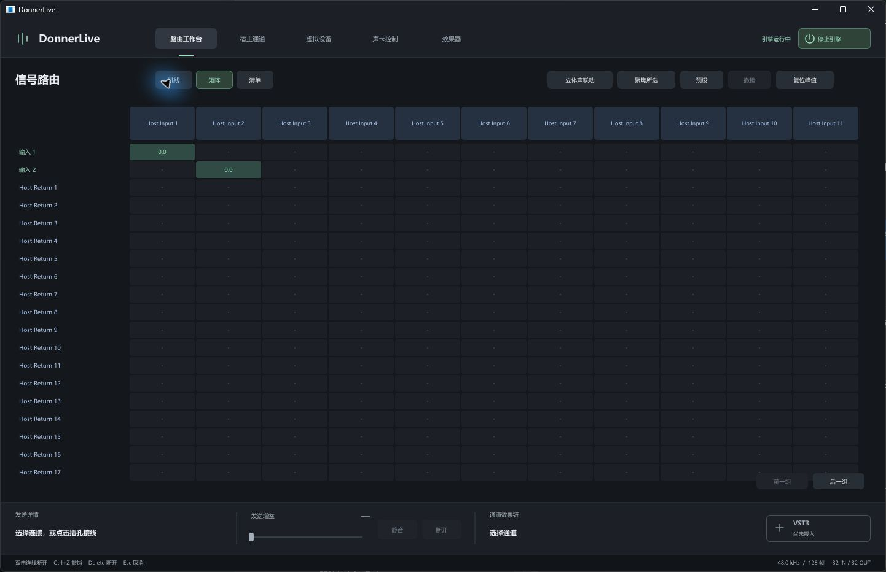
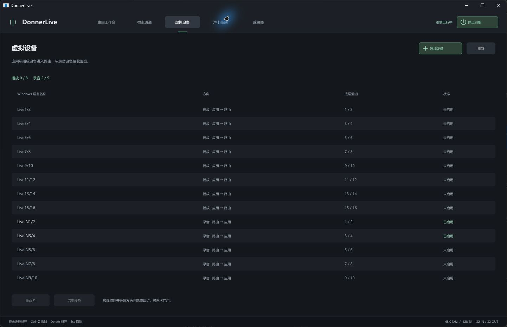
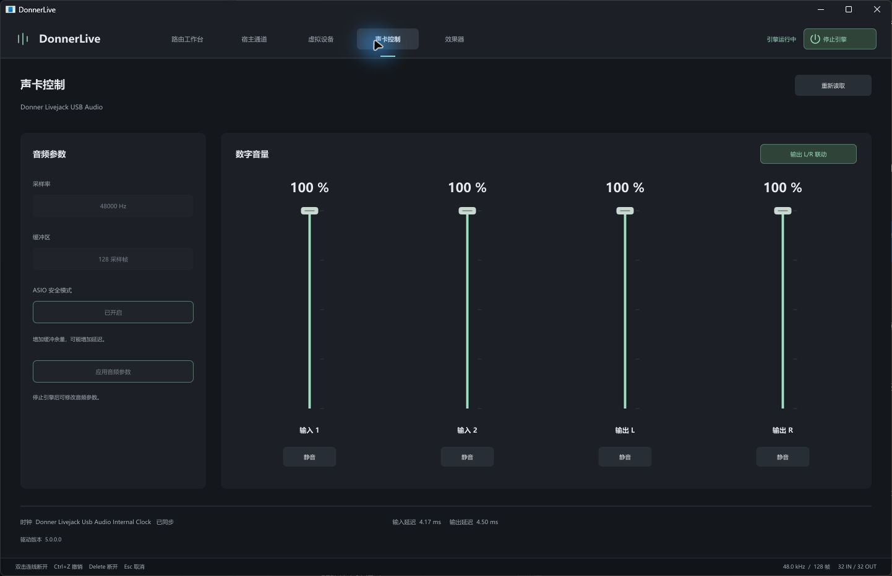

<p align="center">
  
</p>

<p align="center">
  English · <a href="README.zh-CN.md">简体中文</a>
</p>

<p align="center">
  <a href="https://github.com/Meltavalon/DonnerLive/releases/latest"><strong>Download for Windows x64</strong></a>
</p>

An audio control and patch-routing tool for the Donner Livejack on Windows. It uses the
[Elgato Wave Link Driver](https://www.elgato.com/us/en/s/wave-link-app) to provide virtual audio devices
and interfaces, adding virtual outputs and patch routing to the sound card.

<p align="center"><strong>Routing matrix</strong></p>
<p align="center">
  <a href="assets/readme/routing-matrix.jpg"></a>
</p>

<table>
  <tr>
    <td width="50%" align="center"><strong>Virtual devices</strong></td>
    <td width="50%" align="center"><strong>Sound card controls</strong></td>
  </tr>
  <tr>
    <td><a href="assets/readme/virtual-devices.jpg"></a></td>
    <td><a href="assets/readme/sound-card.jpg"></a></td>
  </tr>
</table>

## Features

- 32 ASIO inputs and 32 returns, with connections shown for the channels requested by the host.
- Patch, matrix, and connection-list views, with per-send gain, mute, disconnect, and undo.
- Virtual endpoint enable/disable and renaming; sample rate, buffer size, safety mode, and sound card digital volume and mute controls.
- Audio processing continues in the system tray. Fully exiting stops audio and restores the driver mixer crosspoints used by the application.

## Quick Start

Windows x64 is required. First install the official Donner Livejack driver and a compatible Elgato
Wave Link driver, then install `DonnerLive-<version>-Setup-x64.exe` from Releases. The installer registers
DonnerLive ASIO; the uninstaller removes the registration associated with that installation directory.

**The Elgato Wave Link driver is not included.**

Start DonnerLive, then select **DonnerLive ASIO** in your DAW. In REAPER, disable
“Close audio device when stopped and application is inactive.” Otherwise, switching back to DonnerLive
causes the host to release its channels, which also hides them in the interface.
If the sound card unexpectedly restarts, restart the engine manually.

The current virtual backend recognizes the Wave Link device with ID `VID_0FD9&PID_0096`.
The sound card control interface requires the official driver to be installed.

## Build from Source

Prepare the following environment and make sure the build tools are on `PATH`:

- Windows x64 and Visual Studio 2022 or later, with the **Desktop development with C++** workload, MSVC x64 tools, and Windows SDK.
- CMake 3.24 or later, Ninja, and GNU Make. The CMake and Ninja versions bundled with Visual Studio can be used.
- Internet access for the first build to download JUCE 9.0.4 and ASIO SDK 2.3.4. CMake pins the download URLs and verifies SHA256 checksums.

Open **x64 Native Tools Command Prompt for VS**, navigate to the project root, and run:

```sh
make
```

On Windows, GNU Make may be named `mingw32-make`; use that command name if applicable.
The ASIO DLL, engine, and GUI are all built with MSVC. No separate DLL preparation or replacement is needed.
Building does not require a connected sound card or installed vendor drivers.

The outputs are `build/bin/DonnerLive.exe` and `build/bin/DonnerLive.ASIO.dll`.
The engine is statically linked into the application, and the ASIO DLL is also embedded as an application resource.
You can launch the application directly from this directory to use the control and routing interface.

**To use DonnerLive ASIO in a DAW, run the Setup installer to register the ASIO driver.**

## Build the Installer

Install [NSIS 3](https://nsis.sourceforge.io/Download), add the directory containing `makensis.exe` to `PATH`, and run:

```sh
make setup
```

This command builds all components, then generates `build/installer/DonnerLive-1.0.0-Setup-x64.exe`.
The installer includes the application, ASIO DLL, and third-party license notices, and creates Start menu shortcuts.
Upload the Setup file to Releases. The entire `build/` directory is excluded from version control.

## Project Structure

```text
DonnerLive/
├── assets/readme/                         Cover artwork and application screenshots
├── src/
│   ├── asio/
│   │   ├── driver.hpp / driver.cpp       ASIO interface and host callbacks
│   │   ├── entry.cpp                     COM factory and DLL exports
│   │   └── sdk.hpp                       SDK interfaces and structure packing
│   ├── engine/
│   │   ├── service.hpp / service.cpp     Engine thread, commands, and lifecycle
│   │   ├── runtime.hpp / runtime.cpp     Device startup, control polling, and shutdown
│   │   ├── runtime_audio.cpp             Real-time audio callbacks and mixing
│   │   ├── asio_backend.hpp              Vendor ASIO device backend
│   │   ├── audio_fifo.hpp                Audio FIFOs between backends
│   │   ├── protocol.hpp / routing_v2.hpp Audio shared memory and routing control protocol
│   │   ├── audio_config.hpp / host_config.hpp / host_usage.hpp
│   │   │                                 Audio configuration, channel names, and host state
│   │   └── driver_*.hpp / endpoints.hpp / mixer_guard.hpp
│   │                                     Driver paths, settings, endpoints, and mixer restoration
│   ├── panel/
│   │   ├── core/                         GUI session submission and volume calibration
│   │   ├── studio/                       Port, meter, and connection layout models
│   │   └── juce/
│   │       ├── main.cpp                  Application, window, and system tray
│   │       ├── commands.*                Command-line entry points and configuration directory
│   │       ├── application_support.hpp   Embedded driver, tray, and ASIO registration checks
│   │       ├── workbench.*               Workbench state and interaction
│   │       └── workbench_rendering.cpp / style.hpp
│   │                                     Workbench rendering and styling
│   └── platform/windows.hpp              Windows headers and platform conventions
├── CMakeLists.txt                         Dependencies, build, installation, and Setup definitions
├── Makefile                               Build entry point
├── README.md                              English usage and build instructions
├── README.zh-CN.md                        Chinese usage and build instructions
├── LICENSE                                Full project AGPLv3 license
├── LICENSE-GPL-3.0                         Full GPLv3 license for the ASIO dependency
├── THIRD_PARTY_NOTICES.md                  Third-party versions and licensing
├── .clang-format / .editorconfig / .gitattributes
│                                          Source formatting and text conventions
├── .gitignore                             Local file exclusions
├── config/                                Local development configuration, generated at runtime and ignored
└── build/                                 Downloaded dependencies and all build outputs, ignored
```

## Configuration and Recovery

Installed copies store configuration in `%LOCALAPPDATA%\DonnerLive\config\`. When launched from this
project's build directory, the application uses `config/` in the project root instead.
The files `routing.txt`, `host.txt`, and `audio.txt` store routes, channel names, and sound card settings
confirmed by reading them back from the device. These files are excluded from version control.
When configuration is absent, the application uses default routes, default names, and the device's current
valid settings. Changes are saved after they succeed.

Logs and mixer restoration snapshots are stored in `%LOCALAPPDATA%\DonnerLive\logs\`.
A normal exit restores the driver mixer. After an abnormal exit, pass
`--restore-mixer <snapshot-file-path>` to `DonnerLive.exe` to restore the corresponding snapshot.
The command line also supports `--status`, `--device-status`, `--connect <source> <destination> <dB/off>`,
`--preset host/direct/mute`, `--load <routing-file>`, `--stop`, and `--quit`. Channel numbers start at 1.

## License

The project source is licensed under **AGPL-3.0-only**, which permits commercial use. See [LICENSE](LICENSE).
JUCE is used under its AGPLv3 option, and the ASIO SDK under its GPLv3 option.
See [THIRD_PARTY_NOTICES.md](THIRD_PARTY_NOTICES.md) for details. When distributing binaries, provide
the corresponding source, build instructions, and license files as required by the applicable licenses.
For closed-source use of JUCE, review its commercial licensing requirements separately.
