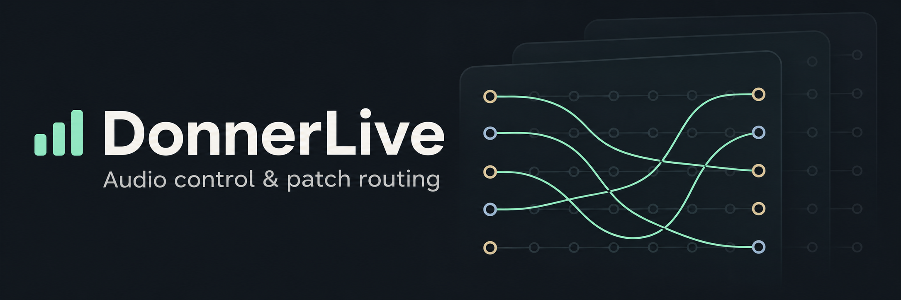
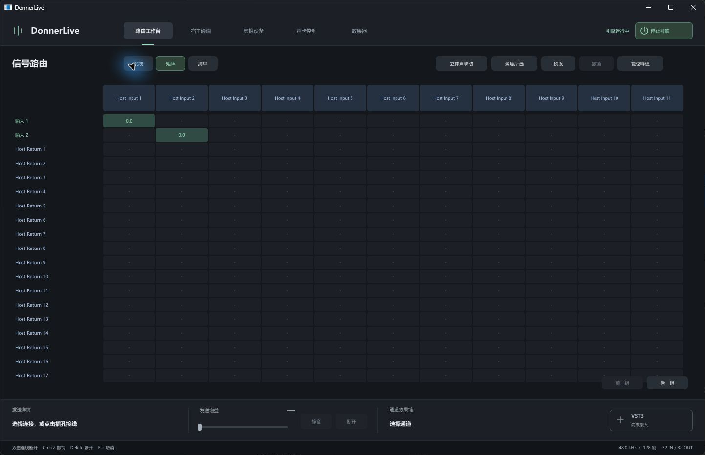
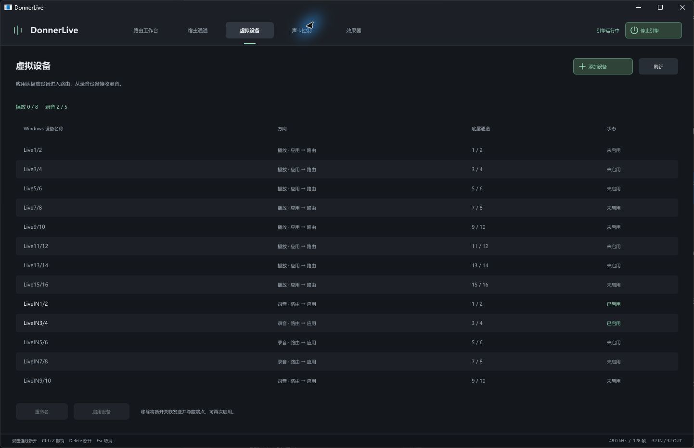
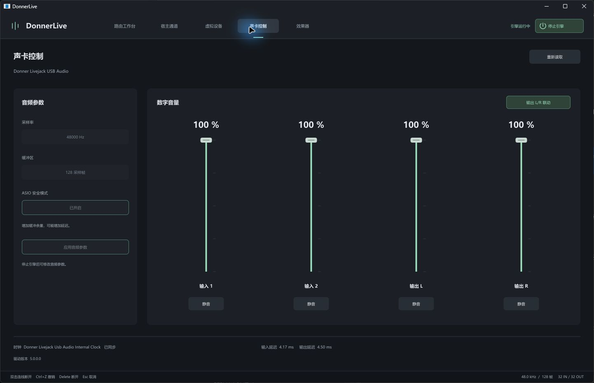

<p align="center">
  
</p>

<p align="center">
  <a href="README.md">English</a> · 简体中文
</p>

<p align="center">
  <a href="https://github.com/Meltavalon/DonnerLive/releases/latest"><strong>下载 Windows x64 安装版</strong></a>
</p>

Windows 上的 Donner Livejack 声卡控制与跳线路由工具。借由 [Elgato Wave Link Driver](https://www.elgato.com/us/en/s/wave-link-app) 提供虚拟音频设备及接口, 补齐声卡的虚拟输出,跳线功能。

<p align="center"><strong>路由矩阵</strong></p>
<p align="center">
  <a href="assets/readme/routing-matrix.png"></a>
</p>

<table>
  <tr>
    <td width="50%" align="center"><strong>虚拟设备</strong></td>
    <td width="50%" align="center"><strong>声卡控制</strong></td>
  </tr>
  <tr>
    <td><a href="assets/readme/virtual-devices.png"></a></td>
    <td><a href="assets/readme/sound-card.png"></a></td>
  </tr>
</table>

## 功能

- 32 路 ASIO 输入和 32 路返回，按宿主实际申请的通道显示连接。
- 跳线、矩阵和连接清单；逐发送增益、静音、断开及撤销。
- 虚拟端点启停与改名；采样率、缓冲、安全模式、声卡数字音量和静音控制。
- 隐藏到托盘后继续处理音频；完全退出时停止音频并恢复占用的驱动混音交叉点。

## QuickStart

确认运行环境为 Windows x64。先安装 Donner Livejack 原厂驱动及兼容的 Elgato Wave Link 驱动，
再安装 Release 中的 `DonnerLive-版本号-Setup-x64.exe`。安装程序会注册 DonnerLive ASIO，
卸载时会移除本安装目录对应的注册。

注意：项目**不附带** Elgato Wave Link驱动。

启动 DonnerLive 后，在 DAW 中选择 **DonnerLive ASIO**。REAPER 用户需关闭
“停止且应用不活跃时关闭音频设备”，否则切回 DonnerLive 时宿主会释放通道，界面也会隐藏这些通道。
若声卡因意外重启，需要手动重新启动引擎。

当前虚拟后端识别 Wave Link 的 `VID_0FD9&PID_0096` 设备；声卡控制接口要求已安装官方驱动程序。

## 从源码构建

准备以下环境，并让构建工具位于 `PATH`：

- Windows x64，Visual Studio 2022 或更新版本，安装“使用 C++ 的桌面开发”、MSVC x64 和 Windows SDK。
- CMake 3.24 或更新版本、Ninja，以及 GNU Make。可使用 Visual Studio 随附的 CMake 和 Ninja。
- 首次构建需要联网下载 JUCE 9.0.4 和 ASIO SDK 2.3.4；CMake 固定下载地址并校验 SHA256。

在 **x64 Native Tools Command Prompt for VS** 中进入项目根目录，执行：

```sh
make
```

Windows 上 GNU Make 的程序名也可能是 `mingw32-make`，此时使用同名命令即可。
ASIO DLL、引擎和 GUI 全部使用 MSVC 编译，无需另外准备或替换 DLL。
编译不要求连接声卡或安装厂商驱动。

产物为 `build/bin/DonnerLive.exe` 和 `build/bin/DonnerLive.ASIO.dll`。
引擎作为静态库链接进主程序，ASIO DLL 同时内嵌到主程序资源。
直接启动此目录中的主程序可以使用控制与路由界面；

注意：如需让 DAW 使用 DonnerLive ASIO，需运行 Setup 安装以注册ASIO设备。

## 生成安装程序

另外安装 [NSIS 3](https://nsis.sourceforge.io/Download)，将 `makensis.exe` 所在目录加入 `PATH`，执行：

```sh
make setup
```

该命令会先完成全部编译，再生成 `build/installer/DonnerLive-1.0.0-Setup-x64.exe`。
安装程序包含应用、ASIO DLL 和第三方许可声明，并创建开始菜单入口。
上传该 Setup 文件到 Release 即可；整个 `build/` 已排除在版本控制之外。

## 项目结构

```text
DonnerLive/
├── assets/readme/                         扉页图与程序实机截图
├── src/
│   ├── asio/
│   │   ├── driver.hpp / driver.cpp       ASIO 接口与宿主回调
│   │   ├── entry.cpp                     COM 工厂与 DLL 导出
│   │   └── sdk.hpp                       SDK 接口及结构打包约定
│   ├── engine/
│   │   ├── service.hpp / service.cpp     引擎线程、命令与生命周期
│   │   ├── runtime.hpp / runtime.cpp     设备启动、控制轮询与关闭
│   │   ├── runtime_audio.cpp             实时音频回调与混音
│   │   ├── asio_backend.hpp              原厂 ASIO 设备后端
│   │   ├── audio_fifo.hpp                后端之间的音频 FIFO
│   │   ├── protocol.hpp / routing_v2.hpp 音频共享区与路由控制协议
│   │   ├── audio_config.hpp / host_config.hpp / host_usage.hpp
│   │   │                                 音频配置、通道名称与宿主状态
│   │   └── driver_*.hpp / endpoints.hpp / mixer_guard.hpp
│   │                                     驱动路径、参数、端点与混音恢复
│   ├── panel/
│   │   ├── core/                         GUI 会话提交与音量校准
│   │   ├── studio/                       端口、电平和连线布局模型
│   │   └── juce/
│   │       ├── main.cpp                  应用、窗口与托盘
│   │       ├── commands.*                命令行入口与配置目录
│   │       ├── application_support.hpp   内嵌驱动、托盘与 ASIO 注册状态读取
│   │       ├── workbench.*               工作台状态及交互
│   │       └── workbench_rendering.cpp / style.hpp
│   │                                     工作台绘制与样式
│   └── platform/windows.hpp              Windows 头文件与平台约定
├── CMakeLists.txt                         依赖、编译、安装与 Setup 定义
├── Makefile                               构建入口
├── README.md                              英文使用与构建说明
├── README.zh-CN.md                        中文使用与构建说明
├── LICENSE                                项目 AGPLv3 全文
├── LICENSE-GPL-3.0                         ASIO 依赖的 GPLv3 全文
├── THIRD_PARTY_NOTICES.md                  第三方版本与许可说明
├── .clang-format / .editorconfig / .gitattributes
│                                          源码格式与文本规范
├── .gitignore                             本地文件排除规则
├── config/                                本地开发配置，运行时生成并忽略
└── build/                                 自动下载的依赖和全部构建产物，忽略
```


## 配置与恢复

安装版配置位于 `%LOCALAPPDATA%\DonnerLive\config\`；从本项目构建目录启动时，配置位于根目录的
`config/`。其中 `routing.txt`、`host.txt` 和 `audio.txt` 分别保存路由、通道名称及已回读确认的声卡设置。
这些文件不纳入版本控制。缺少配置时使用默认路由、默认名称和设备当前有效参数，成功修改后再保存。

日志与混音恢复快照位于 `%LOCALAPPDATA%\DonnerLive\logs\`。正常退出会恢复驱动混音；
异常退出后，可向 `DonnerLive.exe` 传入 `--restore-mixer 快照文件路径` 恢复对应快照。
命令行还支持 `--status`、`--device-status`、`--connect 来源编号 去向编号 dB/off`、
`--preset host/direct/mute`、`--load 路由文件`、`--stop` 和 `--quit`，通道编号从 1 开始。

## 授权

项目源码采用 **AGPL-3.0-only**，允许商业使用，见 [LICENSE](LICENSE)。
JUCE 使用其 AGPLv3 授权选项，ASIO SDK 使用其 GPLv3 授权选项，
详见 [THIRD_PARTY_NOTICES.md](THIRD_PARTY_NOTICES.md)。分发二进制时须按许可提供相应源码、构建说明和许可文件。
如需以闭源方式使用 JUCE，应另行确认其商业许可要求。
